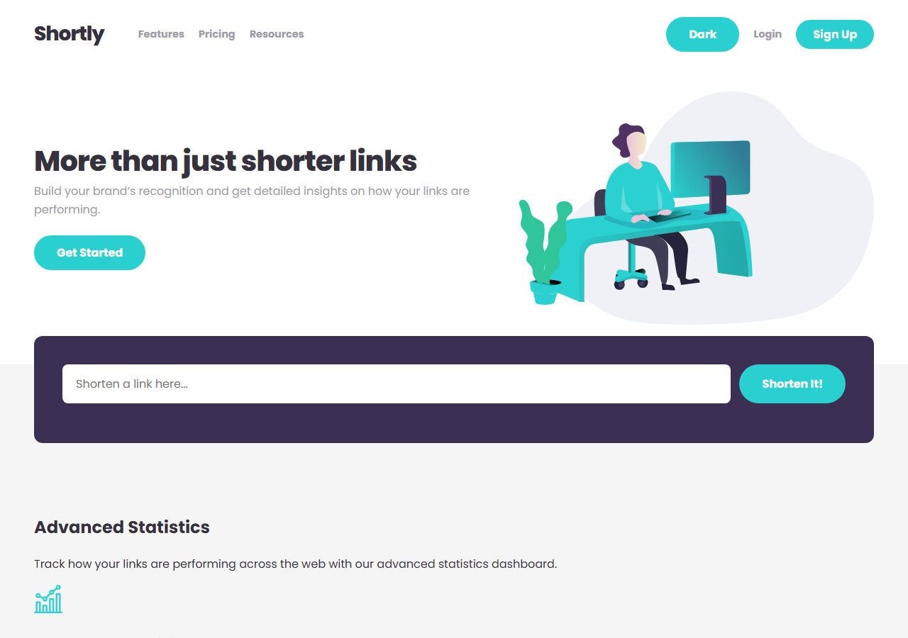

# Shortly – URL Shortener (React + TypeScript)

## Live Demo

**[url-shortner-using-react.vercel.app](https://url-shortner-using-react.vercel.app/)**



## About

Shortly is a website where you paste a long link and get a short one back, like turning a long YouTube or Amazon link into something like `bit.ly/3Xcyo0R`. It uses the bitly API to make the short links.

I first built this project with plain HTML, CSS and JavaScript, then rebuilt it in React with TypeScript.

## Features

- Paste a long link and click **Shorten It!** to get a short bitly link
- See your long and short links in a list under the form
- Click **Copy** to copy the short link (the button changes to "Copied!")
- Links are saved in the browser, so they're still there after a refresh
- Error message if the box is empty or the link doesn't start with `http`
- The button says "Shortening..." while it waits for bitly
- Dark / Light theme toggle
- Works on phones and computers

## Built With

- React
- TypeScript
- Vite
- bitly API
- CSS
- Deployed on Vercel

## How to Run It

1. Clone the repo and go into the app folder:

   ```bash
   git clone https://github.com/DimsuCodes/Url-shortner-using-React.git
   cd Url-shortner-using-React/url-shortener-react
   ```

2. Install the packages:

   ```bash
   npm install
   ```

3. Get a free API token from [bitly](https://bitly.com/). Then make a file called `.env.local` in the `url-shortener-react` folder with this line:

   ```
   VITE_BITLY_KEY=your_bitly_token
   ```

4. Start the app:

   ```bash
   npm run dev
   ```

## Project Structure

```
url-shortener-react/src
├── App.tsx                  holds the list of links and puts the page together
├── components/
│   ├── Header.tsx           logo, nav links and the theme toggle
│   ├── ThemeToggle.tsx      button that switches dark / light mode
│   ├── Hero.tsx             top section with the main heading
│   ├── ShortenedForm.tsx    the form: checks the link, calls bitly, shows loading and errors
│   ├── LinkItem.tsx         one saved link with a Copy button
│   ├── Features.tsx         "Advanced Statistics" section, maps over the feature list
│   ├── FeatureCard.tsx      one feature card (icon, title, text)
│   ├── Button.tsx           reusable button that uses children
│   ├── Boost.tsx            "Boost your links today" section
│   └── Footer.tsx           footer links and social icons
├── context/
│   └── ThemeContext.tsx     shares the theme with the whole app
├── hooks/
│   └── useLocalStorage.ts   custom hook: like useState, but saves to localStorage
└── types/
    └── index.ts             the ShortLink type
```

## React Concepts Used

- **Components with typed props** (TypeScript interfaces)
- **children** for a reusable Button
- **useState** for the form input, errors, loading and the copy button
- **useEffect** to save to localStorage and to set the theme on the page
- **Context API** for the dark / light theme
- **Custom hook** (`useLocalStorage`)
- **Lists with keys** (`.map()` with a unique `id`)
- **Controlled form** and **conditional rendering**

## Known Limitation

The bitly key is used in the browser, so it can be seen in the live site's code. A future improvement is to move the bitly call to a small backend server so the key stays secret.

## Reflection

See [REFLECTION.md](./REFLECTION.md).

## Credits

- Challenge by [Frontend Mentor](https://www.frontendmentor.io/challenges/url-shortening-api-landing-page-2ce3ob-G)
- Coded by [DimsuCodes](https://github.com/DimsuCodes)
